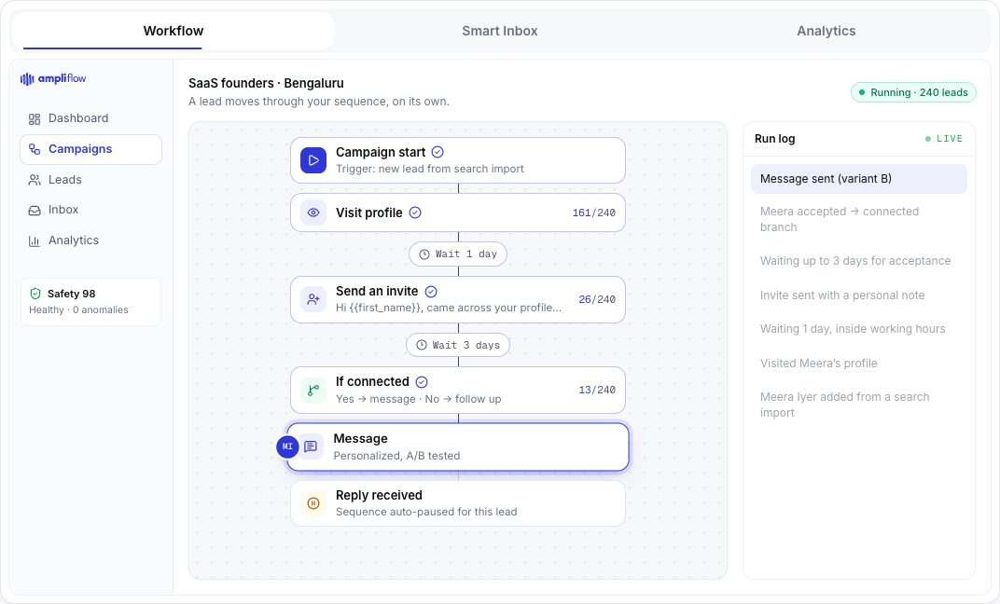
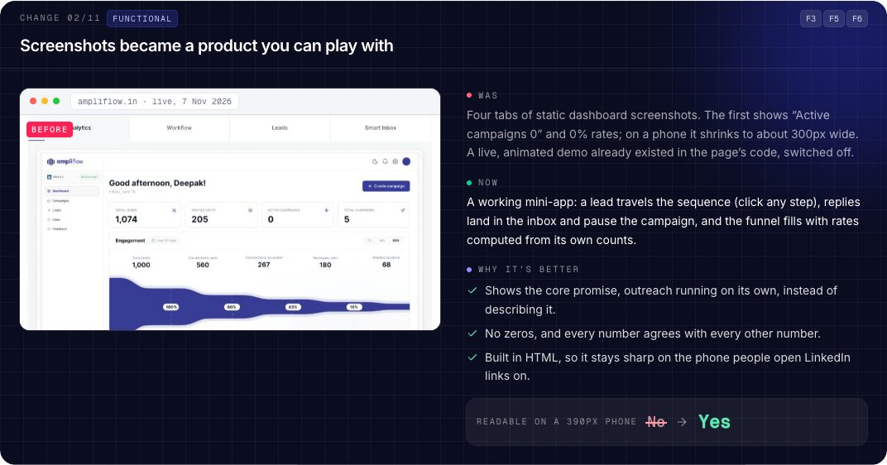

# Ampliflow homepage, redesigned

An **unofficial redesign concept** of the [ampliflow.in](https://ampliflow.in) homepage by **Vansh Srivastava**, made as part of an application for Ampliflow's Frontend Developer Intern role. It is not affiliated with Ampliflow.

**Live:** https://ampliflow-concept-vansh.vercel.app


The page keeps Ampliflow's own copy and brand and reworks the UI to turn more visitors into sign-ups. On top of it are two ways to see what changed and why:

- **Before/after cards.** A dark card under each changed section shows a screenshot of the live section (captured 7 Nov 2026), what was there, what replaced it, why that's better, and a measured before → after number. The **Before/after cards** switch in the top ribbon hides them for a clean view.
- **Redesign notes.** The button in the corner lists 14 things noticed on the live page, grouped as Functional, Trust and Layout. Each entry says what was found, why it costs sign-ups and what changed. **Show me** jumps to the fix and highlights it.

## What changed

| | Change | Before → after | Notes |
|---|---|---|---|
| 1 | Signup takes one step. The email goes straight to sign-up, with Google next to it. | Times you type your email: **2 → 1** | F1 |
| 2 | A playable product demo replaces the static screenshots: workflow run, smart inbox, analytics. | Readable on a 390px phone: **No → Yes** | F3 F5 F6 |
| 3 | A proof strip under the demo, using facts from Ampliflow's own page. | "$700K" appears down the page (desktop): **92% → 15%** | T1 |
| 4 | Safety gets its own section, with an animated score, daily limits and pacing. | Safety score visible: **Hidden → Shown** | F4 |
| 5 | A one-tap persona switcher replaces the tall hub diagram. | Section height on a phone: **1,800 → 578px** | L3 |
| 6 | "Five systems", each shown working. | Section height on a phone: **1,996 → 621px** | T4 L2 |
| 7 | How it works becomes a timeline that fills as you scroll. | Section height on a phone: **1,867 → 628px** | L2 |
| 8 | All three plans are on the homepage at their real prices. | Plans on the homepage: **1 → 3** | T5 |
| 9 | Testimonials use initials instead of stock photos, with quotes unchanged. | Stock photos: **6 → 0** | T2 |
| 10 | The launch story is flagged rather than rewritten. | Needs a decision | T3 |
| 11 | The page ends with a signup and a "Talk to a founder" option. | Signup forms on the page: **1 → 2** | F2 |
| | **The whole page, on a phone** (cards switched off) | **13,019 → 9,043px** | L1 |

Every claim in the notes was checked against the live site, and copy that couldn't be verified was left as written and flagged. To re-run the checks:

```bash
node tools/verify-live.cjs   # read-only: loads ampliflow.in and checks each notes entry
```

## See it working





## Built with

React 19, TypeScript, Tailwind CSS v4, [Motion](https://motion.dev) and [Motion Primitives](https://github.com/ibelick/motion-primitives), built with Vite and hosted on Vercel. Built with Claude Code.

## Run it locally

Needs Node 22 or newer. The end-to-end tests also need Google Chrome installed.

```bash
npm install
npm run dev          # http://localhost:5173
npm test             # Vitest unit and component tests
npx playwright test  # builds, serves on :4173, runs desktop + mobile end-to-end tests
npm run build        # production build in dist/
```

## Project layout

```
src/
  content/       all copy and data: site.ts (Ampliflow's words), notes.ts, changes.ts, demo.ts
  sections/      one component per page section; demo/ holds the three product-demo tabs
  changes/       before/after cards, the page-length card and the image viewer
  notes/         the Redesign notes corner and "Show me"
  fx/            motion helpers: word reveals, count-ups, confetti, scroll bar
  lib/ hooks/    signup URL, funnel maths, auto-advancing tabs, small shared stores
  components/    shared UI; motion-primitives/ is vendored from ibelick/motion-primitives (MIT)
public/before/   screenshots of the live ampliflow.in sections, captured 7 Nov 2026
e2e/             Playwright tests
tools/           screenshot and live-site verification scripts
docs/            design spec and build plan
```

## Quality checks

- **Tests:** 45 unit and component tests. 71 Playwright end-to-end tests pass across desktop and mobile; 7 are skipped where a test only applies to one device.
- **Lighthouse (mobile):** Performance 90 · Accessibility 99 · Best Practices 100 · layout shift 0.
- **Reduced motion:** every animation turns off for visitors with reduced motion enabled, and the demo stops auto-advancing.
- **Honesty:**
  - The page is labelled as a concept in the ribbon, the notes and the footer.
  - It is `noindex` through both a meta tag and a header.
  - It never calls Ampliflow's API. The signup form only opens the public sign-up page with the email in the URL.

## Credits

Copy, brand, logo and product © Ampliflow. The "before" screenshots are of the public ampliflow.in homepage, captured on 7 Nov 2026 for comparison. Motion Primitives components © ibelick, MIT licence. Redesign and code by [Vansh Srivastava](https://linkedin.com/in/vansh-srivastava-whenom/) ([portfolio](https://whenom-interactive.vercel.app/)).
